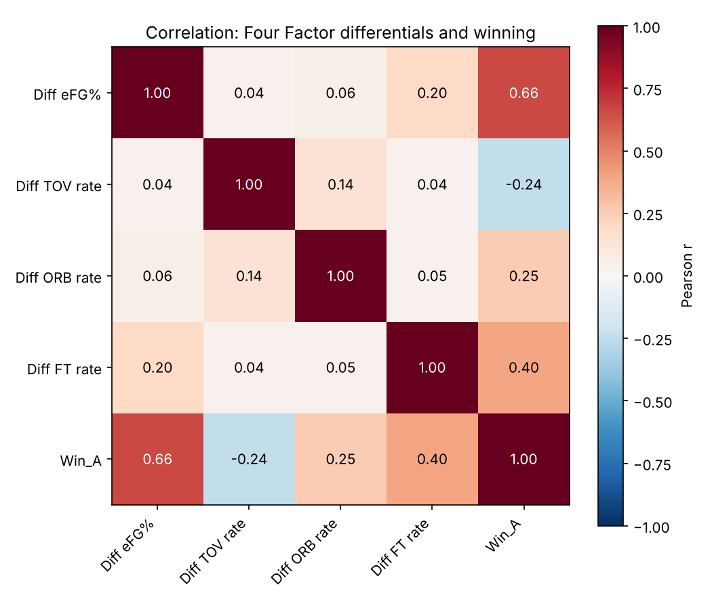
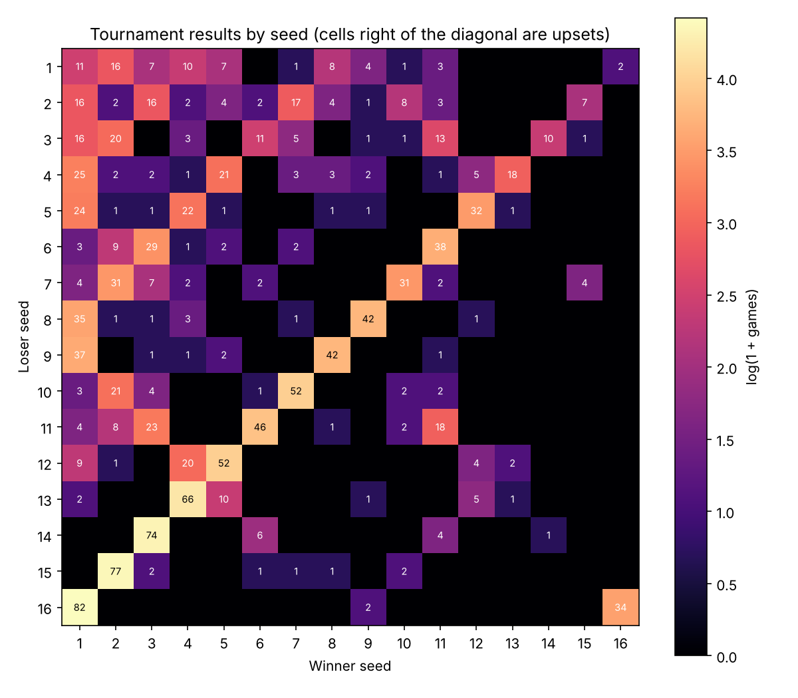
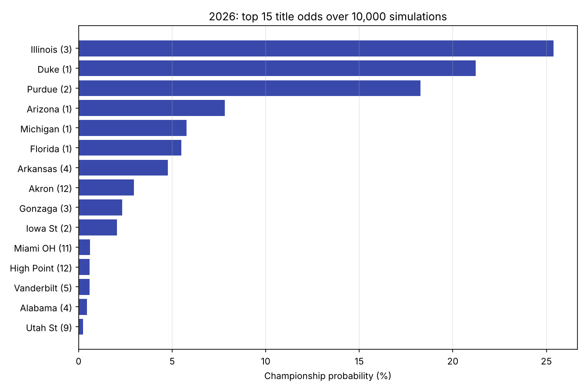

# NCAA Four Factors: What Wins College Basketball Games?

An analysis of 120,000+ Division I men's basketball games (2003–2025) asking which of Dean Oliver's **Four Factors** (shooting, turnovers, rebounding, free throws) best explains winning. The factors then feed a logistic regression and a **10,000-run Monte Carlo simulation** of the NCAA tournament.

Built for ECE 3308 at Texas Tech University.

<p align="center">
  
  
</p>

---

## Key findings

- **Shooting efficiency dominates.** The effective-FG% differential correlates with winning at **r = 0.66**, far ahead of free throw rate (0.40), offensive rebounding (0.25) and turnover rate (−0.24).
- **All four factors carry separate information.** They are only weakly correlated with each other (|r| ≤ 0.20), so the model keeps all four.
- **Seeds hold up.** In 1,382 tournament games from 2003 to 2024, the worse seed won 27.6% of the time.
- **The two 16-over-1 upsets were won differently.** UMBC beat Virginia in 2018 by shooting (+0.220 eFG). Fairleigh Dickinson beat Purdue in 2023 almost entirely on turnovers: about 12 fewer per 100 possessions, with a small shooting edge and worse rebounding and free throw numbers.

The full write-up is in [`reports/EDA_Report.pdf`](reports/EDA_Report.pdf) and [`reports/Feature_Selection_Essay.pdf`](reports/Feature_Selection_Essay.pdf). The notebook [`notebooks/eda.ipynb`](notebooks/eda.ipynb) reproduces every number and figure.

---

## How it works

```
Kaggle box scores ──► build_master_table.py ──► Master_Analytical_Table.csv (one row per game)
                                                        │
                       eda.py / notebooks/eda.ipynb ◄───┤
                                                        ▼
                          simulate_tournament.py:  logistic regression on the 4 differentials
                                                   + each team's season Four Factors
                                                   + 10,000 bracket simulations
                                                        │
                          evaluate_tournament.py ◄──────┘  (score against what actually happened)
```

**Features.** Each game becomes one row. Team A and Team B are assigned at random, and each feature is Team A minus Team B for that game:

| Feature | Formula |
|---|---|
| `DIFF_EFG` | eFG% = (FGM + 0.5 · 3PM) / FGA |
| `DIFF_TOV` | turnovers per 100 possessions; possessions = FGA − OR + TO + 0.475 · FTA |
| `DIFF_ORB` | OR / (OR + opponent DR) |
| `DIFF_FTR` | FTA / FGA |

**No peeking.** To simulate season *S*, the model trains on every regular-season game through *S* and every tournament *before* *S*, so it never sees the games it predicts. For 2025, that is the same 120,264-game table used in the EDA report.

**Simulation.**
- Each tournament team gets its season-long Four Factors.
- The model gives a win probability for every possible pairing of the 68 teams, computed once and cached.
- The full bracket, including the First Four, is played 10,000 times using Kaggle's seed and slot files.
- The output is each team's chance of reaching every round, a most-likely bracket, and four picks: champion, Cinderella, fade, and contrarian.

---

## Results

### 2025 (scored against the real tournament)

| | |
|---|---|
| Most likely champion | Duke (1), 39% of simulations |
| Cinderella | Utah State (10), Sweet 16 in 71% |
| Actual champion | Florida (1), 6% in the model |

`evaluate_tournament.py` compares the model with simple baselines on the 67 games actually played:

| | Games picked correctly | Log loss | Bracket score (ESPN scale, max 1920) |
|---|---|---|---|
| Four Factors model | 68.7% | 0.634 | 690 |
| Seed-only baseline | 73.1% | 0.488 | 1090 (all favorites) |

**The model did worse than just picking the better seed.** The next section explains why.

### 2026 (prediction made before the tournament)

The most likely champion is Illinois (3) at 25%, followed by Duke (1) at 21% and Purdue (2) at 18%. The Cinderella is Akron (12), which reaches the Sweet 16 in 58% of simulations. See [`results/2026/picks.md`](results/2026/picks.md).

<p align="center"></p>

---

## Limitations, and what I'd change next

- **The training features record the game itself.** A game's own shooting and turnover numbers nearly determine who won, so the model hits 94.8% accuracy on held-out games. That accuracy doesn't carry over to prediction, because before a game you only know season averages.
- **Season averages make the probabilities too extreme.** Small season-long gaps get multiplied by coefficients learned from single games. For example, the model gave 4-seed Texas A&M only a 6% chance against 13-seed Yale in 2025.
- **Offense only.** The team profiles use what each team does on offense. They ignore defense (what opponents shoot against them) and strength of schedule, so mid-major teams with gaudy shooting numbers get overrated.
- **Next steps:**
  - Train on pre-game season differentials (offense *and* defense), adjusted for opponent strength.
  - Add seed or a rating system as a feature.
  - Tune the model on past tournaments rather than all games.

---

## Running it

```bash
pip install -r requirements.txt
# put the Kaggle CSVs in data/ (see data/README.md)

python build_master_table.py               # → data/Master_Analytical_Table.csv (120,264 games)
python eda.py                              # → figures/ and summary statistics
python simulate_tournament.py --season 2025
python evaluate_tournament.py --season 2025
python simulate_tournament.py --season 2026
```

Each simulation takes about a second. Everything uses a fixed random seed (42), so the numbers above reproduce exactly.

## Repository layout

```
├── build_master_table.py     # Kaggle box scores → game-level differentials
├── eda.py                    # EDA figures and summary statistics
├── simulate_tournament.py    # train model, simulate bracket, write results/<season>/
├── evaluate_tournament.py    # score a season's bracket against actual results
├── ncaa_ff/                  # shared code: features, model, simulation, plots
├── notebooks/eda.ipynb       # EDA walkthrough with figures
├── figures/                  # EDA figures
├── results/2025, 2026/       # frequency tables, brackets, picks, charts
├── reports/                  # EDA report and feature-selection essay (PDF)
└── data/                     # Kaggle CSVs go here (not included)
```

## Data and credits

- **Box scores, seeds and brackets:** Kaggle's [March Machine Learning Mania](https://www.kaggle.com/competitions/march-machine-learning-mania-2026) competition. They aren't redistributed here; see [`data/README.md`](data/README.md).
- **The Four Factors:** Dean Oliver, *Basketball on Paper* (2004).

## License

[MIT](LICENSE) © 2026 Nicholas Soliz
